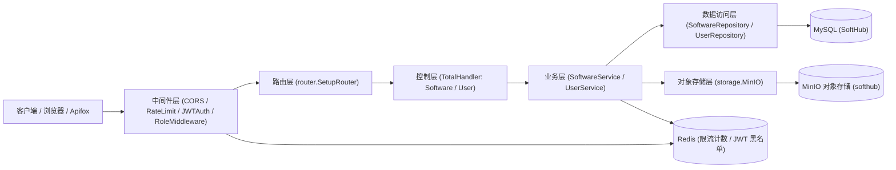

# SoftHub — 软件发布与版本分发后端系统

SoftHub 是一个基于 **Go + Gin + GORM + MySQL + MinIO + Redis + JWT** 构建的软件发布与版本分发后端服务。项目采用标准工程化三层分层架构（`Handler -> Service -> Repository + Storage`），实现了用户认证与 RBAC 权限控制、高并发下的版本安全递增、基于流式传输的对象存储集成，以及预签名直链下载能力。

---

## 技术栈

| 类别 | 技术选型 | 说明 |
| :--- | :--- | :--- |
| 开发语言 | Go `1.27` | 静态编译、高并发原语支持 |
| Web 框架 | Gin (`github.com/gin-gonic/gin`) | 路由分组、中间件链、参数绑定校验 |
| 数据库与 ORM | MySQL + GORM (`gorm.io/gorm`) | 事务管理、行级排他锁、自动表结构迁移 |
| 对象存储 | MinIO (`github.com/minio/minio-go/v7`) | S3 兼容流式上传、私有桶预签名下载直链 |
| 身份认证 | JWT (`github.com/golang-jwt/jwt/v5`) | HS256 无状态 Token 签发与解析校验 |
| 密码安全 | `golang.org/x/crypto/bcrypt` | 自带随机盐值的不可逆密码哈希 |
| 配置管理 | `github.com/joho/godotenv` | `.env` 环境变量加载与集中校验 |

---

## 架构全景与目录结构

### 请求流转架构



### 目录结构

```text
SoftHub/
├── config/
│   └── config.go            # 环境变量读取、默认值兜底与必填配置校验
├── database/
│   ├── mysql.go             # GORM MySQL 连接池配置与 5s 超时 PingContext 探活
│   └── redis.go             # go-redis 客户端初始化与 5s 超时 Ping 探活
├── storage/
│   └── minio.go             # MinIO 客户端封装：探活自动建桶、流式上传、预签名 URL、对象删除
├── model/
│   ├── software.go          # software 表模型定义
│   ├── software_version.go  # software_version 表模型定义（联合唯一索引）
│   └── user.go              # user 表模型定义（隐藏 PasswordHash 序列化）
├── request/
│   ├── auth.go              # 注册、登录请求 DTO 与 Gin binding 校验规则
│   ├── software.go          # 软件创建/更新请求 DTO
│   └── version.go           # 版本创建请求 DTO
├── repository/
│   ├── errors.go            # 数据访问层哨兵错误（ErrUsernameExists）
│   ├── software.go          # 软件与版本 CRUD、级联事务删除、行锁创建版本
│   └── user.go              # 用户查重、创建（拦截 MySQL 1062 错误）与查询
├── service/
│   ├── errors.go            # 业务逻辑层哨兵错误（ErrUsernameTaken 等）
│   ├── software.go          # 软件与版本业务编排、MinIO 流式上传与直链签发
│   └── user.go              # 注册加密、登录签发 Token、管理员启动幂等初始化
├── handler/
│   ├── software.go          # 软件与版本 HTTP 接口处理与参数解析
│   ├── user.go              # 用户认证与个人信息接口、错误状态码映射
│   └── total.go             # TotalHandler 聚合所有模块控制器
├── middleware/
│   ├── cors.go              # 跨域响应头设置与 OPTIONS 预检请求拦截（204）
│   ├── jwt.go               # Bearer Token 解析并将用户信息注入 gin.Context
│   ├── ratelimit.go         # 基于 Redis INCR + EXPIRE 的 IP 固定时间窗口分布式限流器
│   └── role.go              # 基于角色列表的 RBAC 访问控制中间件
├── pkg/
│   ├── response/
│   │   └── response.go      # 统一 JSON 响应格式与 HTTP 状态码封装
│   └── utils/
│       └── jwt.go           # JWT Claims 定义、HS256 Token 签发与校验
├── router/
│   └── router.go            # 公开路由、限流路由、鉴权路由与管理员路由挂载
├── main.go                  # 服务启动入口：配置加载、基础设施连接、依赖注入与服务启动
├── go.mod
└── .env                     # 本地环境变量配置文件（不建议提交至版本库）
```

---

## 核心工程特性

1. **认证、权限与限流安全**
   - **JWT 鉴权**：采用 HS256 对称签名算法，Token 有效期 30 分钟，签发方为 `SoftHub`；中间件解析后将 `user_id`、`username`、`role`，以及原始 `token` 与 `expires_at` 写入请求上下文。
   - **RBAC 权限控制**：`RoleMiddleware(roles ...string)` 校验当前用户角色，非管理员访问管理端接口统一拦截并返回 HTTP `403`。
   - **密码与初始管理员**：用户密码采用 `bcrypt.DefaultCost` 哈希加盐存储，模型层标记 `json:"-"` 防止序列化泄露；服务启动时调用 `EnsureAdmin` 幂等初始化管理员账号。
   - **IP 限流与 CORS**：认证接口（注册、登录）挂载 `RateLimit(rdb, 5, time.Minute)`，使用 Redis 原子 `INCR` 计数，首次请求时 `EXPIRE` 设置窗口 TTL（Key 为 `ratelimit:<IP>`），超限返回 HTTP `429`；全局启用 CORS 跨域中间件并在 `OPTIONS` 预检请求直接返回 `204`。
   - **JWT 登出黑名单**：`POST /api/v1/auth/logout` 将 Token 写入 Redis（Key 为 `jwt:blacklist:<token>`，TTL 为 Token 剩余有效期）；`JWTAuth(rdb)` 在本地验签通过后再查询黑名单，命中返回 `401`。Token 自然过期后 Key 由 Redis 自动回收。

2. **并发安全与事务一致性**
   - **行级排他锁递增版本号**：在 `SoftwareRepository.CreateVersion` 中使用数据库事务配合 `SELECT ... FOR UPDATE` 锁住目标软件记录，原子计算 `COALESCE(MAX(version_id), 0) + 1`，防止并发发布版本时产生序号冲突。
   - **级联删除一致性顺序**：`SoftwareService.Delete` 删除软件时，严格遵循“先查询关联版本列表获取对象 Key $\rightarrow$ 数据库事务级联删除子表 `software_version` 与主表 `software` $\rightarrow$ 事务成功后遍历清理 MinIO 桶中对象”，避免孤儿文件或数据不一致。

3. **MinIO 对象存储与流量卸载**
   - **启动探活与幂等建桶**：`storage.NewMinIO` 启动时使用 5 秒超时上下文执行 `BucketExists` 校验连接与凭证，若目标存储桶不存在则自动调用 `MakeBucket` 创建。
   - **流式上传**：`UploadVersionFile` 限制单文件最大 500MB，直接将 `multipart.File`（`io.Reader`）透传至 `PutObject`，文件字节流不落地服务器本地磁盘，也不整包读入内存。
   - **永久 Key + 动态预签名下载**：数据库 `download_url` 字段仅持久化存储永久对象键（如 `software/1/version-1.zip`）。客户端请求下载接口时，`GetDownloadURL` 实时调用 `PresignedGetObject` 在本地计算 HMAC-SHA256 签名并生成 15 分钟有效的临时直链，大文件下载流量由客户端直连 MinIO，完全旁路 Go 后端。

4. **错误分层与精确映射**
   - **Repository 层**：使用 `errors.As` 提取底层 `*mysql.MySQLError`，拦截错误码 `1062`（唯一索引冲突）并转译为数据层哨兵错误 `ErrUsernameExists`。
   - **Service 层**：将数据库及存储错误收敛为语义明确的业务哨兵错误（如 `ErrUsernameTaken`、`ErrInvalidCredentials`、`ErrUserNotFound`）。
   - **Handler 层**：使用 `errors.Is` 精确区分客户端/业务错误（400/401）与系统内部错误（500），500 分支通过 `_ = c.Error(err)` 交由 Gin Logger 记录底层错误堆栈而不向外部暴露敏感细节。

---

## 数据库表结构说明

服务启动时会自动通过 GORM `AutoMigrate` 创建或同步以下三张单数表（位于 `SoftHub` 库）：

| 表名 | 核心字段 | 约束与说明 |
| :--- | :--- | :--- |
| `SoftHub.software` | `id`, `name`, `description`, `version`, `created_at`, `updated_at` | 软件主表 |
| `SoftHub.software_version` | `id`, `software_id`, `version_id`, `version`, `description`, `download_url`, `created_at`, `updated_at` | `(software_id, version_id)` 建有联合唯一索引 `idx_software_version`；`download_url` 存储 MinIO 对象 Key |
| `SoftHub.user` | `id`, `username`, `password_hash`, `role`, `created_at`, `updated_at` | `username` 建有唯一索引 `idx_user_username`；`role` 默认值为 `user` |

若在本地调试阶段需要清空测试数据并重置自增主键，可在数据库客户端执行：

```sql
SET FOREIGN_KEY_CHECKS = 0;

TRUNCATE TABLE SoftHub.software_version;
TRUNCATE TABLE SoftHub.software;
TRUNCATE TABLE SoftHub.user;

SET FOREIGN_KEY_CHECKS = 1;
```

---

## 快速启动指南

### 1. 环境准备
- Go `1.27+`
- MySQL `8.0+`（提前创建数据库 `SoftHub`）
- Docker 部署的 MinIO 服务（API 端口默认 `9000`）
- Docker 部署的 Redis 服务（默认 `6379`，`redis:7-alpine`，需 `--appendonly yes` 持久化）

如需使用 Docker Compose 快速启动本地 Redis（`docker-compose.yml`）：

```yaml
services:
  redis:
    image: redis:7-alpine
    container_name: redis
    restart: unless-stopped
    ports:
      - "6379:6379"
    volumes:
      - ./data:/data
    command: redis-server --appendonly yes
```

```bash
docker compose up -d
docker exec -it redis redis-cli ping   # 返回 PONG 即成功
```

如需使用 Docker 快速启动本地 MinIO：

```bash
docker run -d \
  --name softhub-minio \
  -p 9000:9000 \
  -p 9001:9001 \
  -e "MINIO_ROOT_USER=your_minio_access_key" \
  -e "MINIO_ROOT_PASSWORD=your_minio_secret_key" \
  quay.io/minio/minio server /data --console-address ":9001"
```

### 2. 配置 `.env` 文件
在项目根目录创建 `.env` 文件（注意 `MINIO_BUCKET` 需遵循 S3 规范全部使用小写字母，`MINIO_ENDPOINT` 不带协议前缀）：

```env
PORT="8080"

DB_USER="root"
DB_PASSWORD="your_mysql_password"
DB_HOST="127.0.0.1"
DB_PORT="3306"
DB_NAME="SoftHub"

JWT_SECRET="your_jwt_secret_key"
ADMIN_USERNAME="admin"
ADMIN_PASSWORD="your_admin_password"

MINIO_ENDPOINT="127.0.0.1:9000"
MINIO_ACCESS_KEY="your_minio_access_key"
MINIO_SECRET_KEY="your_minio_secret_key"
MINIO_BUCKET="softhub"
MINIO_USE_SSL="false"

REDIS_ADDR="127.0.0.1:6379"
REDIS_PASSWORD=""
REDIS_DB="0"
```

### 3. 安装依赖并启动服务

```bash
go mod tidy
go run main.go
```

服务启动后会自动完成 MySQL 连接探活、建表迁移、MinIO 探活与建桶，以及管理员账号初始化。

---

## API 接口与权限矩阵

### 统一响应结构

所有业务接口均返回统一 JSON 格式：

```json
{
  "code": 0,
  "message": "success",
  "data": {}
}
```

常见状态码：`0`（成功，HTTP 200）、`400`（参数或业务校验失败）、`401`（未登录或凭证无效）、`403`（权限不足）、`429`（触发 IP 限流）、`500`（服务器内部错误）。

### 接口总览

| 模块 | 方法与路径 | 权限与中间件 | 请求体 / 说明 |
| :--- | :--- | :--- | :--- |
| 健康检查 | `GET /health` | 公开 | 返回服务存活状态 `{"status": "ok"}` |
| 用户注册 | `POST /api/v1/auth/register` | 公开 + `RateLimit(5, 1m)` | JSON：`username` (3~50位)、`password` (6~72位) |
| 用户登录 | `POST /api/v1/auth/login` | 公开 + `RateLimit(5, 1m)` | JSON：`username`、`password`，返回 JWT `token` |
| 用户登出 | `POST /api/v1/auth/logout` | `JWTAuth()` | 将当前 Token 加入 Redis 黑名单，此后该 Token 返回 `401` |
| 当前用户 | `GET /api/v1/user/me` | `JWTAuth()` | 需携带 `Authorization: Bearer <token>` |
| 软件列表 | `GET /api/v1/software` | 公开 | 按创建时间倒序返回软件列表 |
| 软件详情 | `GET /api/v1/software/:id` | 公开 | 根据软件 ID 查询详情 |
| 版本列表 | `GET /api/v1/software/:id/versions` | 公开 | 按 `version_id` 倒序返回该软件全部版本 |
| 最新版本 | `GET /api/v1/software/:id/versions/latest` | 公开 | 获取该软件最新发布的版本记录 |
| 安装包下载 | `GET /api/v1/software/:id/versions/:versionID/download` | 公开 | 返回 `{"downloadURL": "..."}` 15 分钟有效 MinIO 预签名直链 |
| 批量创建软件 | `POST /api/v1/software` | `JWTAuth()` + `RoleMiddleware("admin")` | JSON 数组：`[{"name": "", "description": "", "version": ""}]` |
| 更新软件信息 | `PUT /api/v1/software/:id` | `JWTAuth()` + `RoleMiddleware("admin")` | JSON：`name`、`description`、`version` |
| 删除软件 | `DELETE /api/v1/software/:id` | `JWTAuth()` + `RoleMiddleware("admin")` | 级联删除软件、所有版本记录及 MinIO 对应文件 |
| 创建软件版本 | `POST /api/v1/software/:id/versions` | `JWTAuth()` + `RoleMiddleware("admin")` | JSON：`version`（必填）、`description`（选填） |
| 上传安装包 | `POST /api/v1/software/:id/versions/:versionID/upload` | `JWTAuth()` + `RoleMiddleware("admin")` | `multipart/form-data`，字段名必须为 `file`（最大 500MB） |
